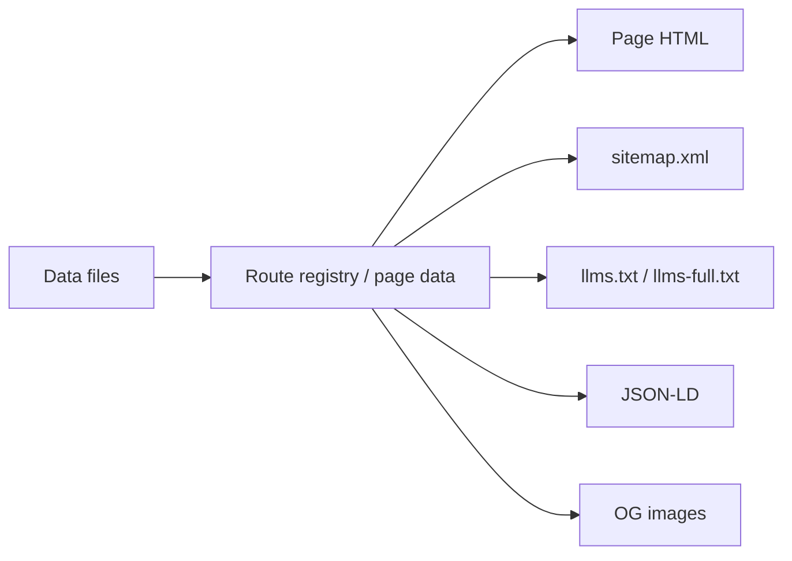

# ARCHITECTURE

## Rendering model
Astro static site generation. Pages are built as static HTML during `npm run build`. No server runtime is required in the current configuration.

## Layout hierarchy
- `src/layouts/BaseLayout.astro` provides `<head>`, header, footer, sticky contact and cookie banner.
- Sectioned pages use `src/components/Section.astro` and `src/components/WaveDivider.astro`.

## Data flow
Mermaid:

## Data files
- `src/data/site.ts`: brand, contacts, domain.
- `src/data/services.ts`: services and FAQs.
- `src/data/cities.ts`: cities, universities, specialties.
- `src/data/pricing.ts`: work types, prices, deadlines, coefficients.
- `src/data/prices.ts`: alias for pricing.
- `src/data/navigation.ts`: servicesNav, mainNav, footerGroups.
- `src/data/faq.ts`, `src/data/guarantees.ts`, `src/data/heroCopy.ts`, `src/data/stats.ts`.

## Shared components
- `Hero.astro`: hero text and bullets.
- `QuickOrder.astro`: calculator and two-step form.
- `LeadForm.astro`: contact form.
- `PricingTable.astro`: price table.
- `ServicePage.astro`: service page template.
- `LocalUniversities.astro`, `OtherCities.astro`, `LinkCardGrid.astro`: city-related blocks.
- `Breadcrumbs.astro`, `FAQ.astro`, `Guarantees.astro`.

## Calculator logic
- Client-side in `QuickOrder.astro`, uses serialized `pricing`.
- Formula source: `src/utils/price.ts` and inline `calc`.
- Coefficients and prices come from `src/data/pricing.ts`.

## Forms
- `LeadForm.astro`: name, contact, work type, comment, consent.
- `QuickOrder.astro` step 2: qo_name, qo_contact, qo_comment, consent.
- `StickyContact.astro`: name, phone, work type, consent.
- All forms post through `FormData`; current implementation is mock or `api/lead` (see site code).

## Scripts
- `scripts/generate-icons.mjs`
- `scripts/generate-og.mjs`
- `scripts/generate-llms.mjs`
- `scripts/generate-robots.mjs`
- `scripts/check-seo.mjs`
- `scripts/check-encoding.mjs`
- `scripts/routes.mjs`

## Build pipeline
prebuild: generate icons, OG images, llms, robots; build static pages; sitemap integration. Post-build checks: `check:seo`, `check:encoding`, `routes`.
## Forms and Telegram
Client form -> /api/lead (Cloudflare Pages Function) -> Telegram sendMessage. Secrets stay in Cloudflare env.
